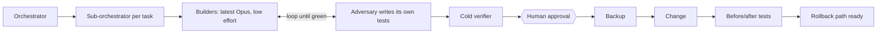

# One consultant, agent-team output: governed AI delivery for data engineering

[](https://github.com/AlbertDeWet/ai-delivery-showcase/actions/workflows/ci.yml)

**Across four projects, adversarial agents wrote 556 tests of their own and raised 188 findings
(21 critical), and the builders closed every critical one before GO. Every number here traces to a
recorded run in a project's `results/` folder.**

Four data-engineering problems, each solved by **directing a team of Claude Code agents**:
an orchestrator, a sub-orchestrator per task, fast builder agents, and an **adversarial agent
that writes its own tests** and keeps attacking until the builder's work holds. Each change the
tools make is gated: a backup first, the same tests before and after, a rollback path and a human
approval.

My role (Albert de Wet): I set the scope and requirements, made the design decisions, gave the
approvals, ruled on disputes between builder and adversary, and reviewed the results. The agents
wrote the code, the tests and the first drafts of the docs.

Each project re-creates the shape of a real problem from client work for a large financial-services client
([case studies](method/case-studies.md)) on **synthetic data only** ("Contoso Insurance (fictional
sample data)").

## Start here: the 5-minute path

```bash
cd projects/03-delta-pipeline-recovery
python -m venv .venv
.venv/Scripts/pip install -r requirements.txt     # Linux/macOS: .venv/bin/pip
.venv/Scripts/python run_demo.py                  # Linux/macOS: .venv/bin/python
```

It corrupts a Delta table with a bad load, recovers the month from time travel after a verified
backup, reconciles 600 cells to the cent, then injects a fault and shows the automatic rollback.
Then read its [README](projects/03-delta-pipeline-recovery/README.md) and
[ADVERSARIAL-LOG.md](projects/03-delta-pipeline-recovery/ADVERSARIAL-LOG.md).

## Projects

| # | Project | Problem shape | Result |
|---|---|---|---|
| 01 | [nl2sql-evals](projects/01-nl2sql-evals) | Natural-language-to-SQL, graded by executing the SQL | Haiku 98.1% / Sonnet 96.9% vs baseline 75.9%; held-out 93.3% vs 46.7%. [Caveats](projects/01-nl2sql-evals/README.md#results) |
| 02 | [databricks-env-alignment](projects/02-databricks-env-alignment) | Aligning DEV/UAT/PROD; refusing a risky bundled release | DEV->PROD views 32 -> 38 of 39 aligned; protected team 0 differences. [Details](projects/02-databricks-env-alignment/README.md) |
| 03 | [delta-pipeline-recovery](projects/03-delta-pipeline-recovery) | Recovering lost ledger rows before the time-travel deadline; de-dup | 600/600 cells to the cent; doubled months 9 -> 0. [Details](projects/03-delta-pipeline-recovery/README.md) |
| 04 | [semantic-model-guard](projects/04-semantic-model-guard) | Trimming an oversized semantic model safely | Broken measures -> 0, 3/3 reports pass, held for sign-off. [Details](projects/04-semantic-model-guard/README.md) |

Every project has `tests/` (builder), `tests/adversarial/` (written by the adversary) and an
`ADVERSARIAL-LOG.md` showing which adversary tests failed first and what was fixed.

> **What this proves**
> - The method works end to end: adversary tests failed first, were fixed, and the logs show each round.
> - The tools refuse unsafe changes, back up first, compare before and after, and roll back.
> - The numbers are reproducible: each comes from a recorded run you can re-run locally.
>
> **What it does not prove**
> - Production scale or real data: all data is **synthetic** and small.
> - Real platforms: everything runs **locally** (DuckDB, delta-rs, files standing in for workspaces); no Databricks, Power BI service or cloud.
> - Real waiting: 03's retention deadline uses a **simulated clock**.
> - Completion of human steps: 04's trim stays **pending human sign-off** by design (exit code 3).
> - Live model results in CI: 01's Claude tiers ran through a subscription CLI on one machine, and Opus was not run.

## The method, in one picture



- **Adversary-driven build loop:** the builder iterates fast against tests it is not allowed
  to edit.
- **Model-routing ladder:** the cheapest adequate model per step, from Haiku to the top tier.
- **Hooks that force process:** a tested guard script (41/41 assertions) blocks a turn from
  ending before checks have run. Honest limits: opt-in, interactive sessions only, fail-open
  by design; the rest of the method is a working rule, not mechanical enforcement.

Read more: [method/README.md](method/README.md) ·
[case studies](method/case-studies.md) · [reusable agent templates](method/agents/) ·
[harness](method/harness/)

## The method in numbers

Taken from each project's `ADVERSARIAL-LOG.md`. Findings are counted as the adversary raised them.

| Project | Rounds | Adversary tests written | Critical | High | Medium | Low | Closed | Final verdict |
|---|---|---|---|---|---|---|---|---|
| 01 NL-to-SQL evals | 2 (after 2 independent reviews) | 81 | 0 | 2 | 10 | 13 | 25 of 25 (A8 partly fixed, residual documented) | GO; 81/81 adversary tests pass |
| 02 env alignment | 5 | 138 | 3 | 13 | 9 | 8 (incl. 1 observation, 1 accepted decision) | 28 of 33; open: H4 (medium, a stated limitation), K1-K2 (low, pinned by strict xfail), K3 (accepted), G8 (observation) | GO; 135 passed + 3 strict xfail |
| 03 pipeline recovery | 5 | 113 | 1 | 10 | 19 | 17 | 47 of 47 | GO at 44/47; all 47 closed after final fixes |
| 04 semantic model guard | 7 | 224 | 17 | 33 | 24 | 9 | 83 of 83 | GO |
| **Total** | **19** | **556** | **21** | **58** | **62** | **47** | **183 of 188** | |

01's independent reviews came before the adversary rounds: the first found 15 issues, answered by
12 fix items (the first review report was not retained); the second recomputed every metric with
zero differences.

Two lessons that held across projects:

- **Home-made SQL parsing failed twice (02).** A regex blocklist, then a hand-written tokenizer, were each bypassed in the next round because their lexing disagreed with DuckDB's. The guard held only once the security decision moved to DuckDB's own parser.
- **A strict allowlist stopped the criticals (04).** After three rounds of patching holes (17 critical findings), the design switched to an explicit allowlist of files, objects, properties and DAX functions. Rounds 4-7 raised no critical findings; later rounds widened the list on purpose instead of discovering bypasses.

## How to run

Requirements: Python 3.13. No cloud, no API keys, no Spark or Java.

```bash
# one project
cd projects/02-databricks-env-alignment
python -m venv .venv && . .venv/bin/activate     # Windows: .venv\Scripts\activate
pip install -r requirements.txt
python -m pytest tests                           # builder + adversary tests
# then the project's one-command run, described in its README

# the harness tests (no dependencies)
python method/harness/test_arc_guard.py

# leak check, and the git hooks that run it on every commit
python scripts/leakcheck.py
python scripts/install_hooks.py
```

CI runs every project's tests on Ubuntu with Python 3.13, plus the harness tests and the leak
check (`.github/workflows/ci.yml`). The latest local run of every suite is in
[results/ci-local.txt](results/ci-local.txt).

## About the author

**Albert de Wet**, business intelligence consultant (Power BI, Databricks, SQL,
Git, Claude Code), open to fully remote AI-engineer, forward-deployed and AI-automation roles.
This repo, its code, tests and docs, was built by directing Claude Code agents with the method
it describes.

- GitHub: [AlbertDeWet](https://github.com/AlbertDeWet)
- LinkedIn: [albert-de-wet-644a61227](https://www.linkedin.com/in/albert-de-wet-644a61227)

Licensed under the [MIT License](LICENSE).
