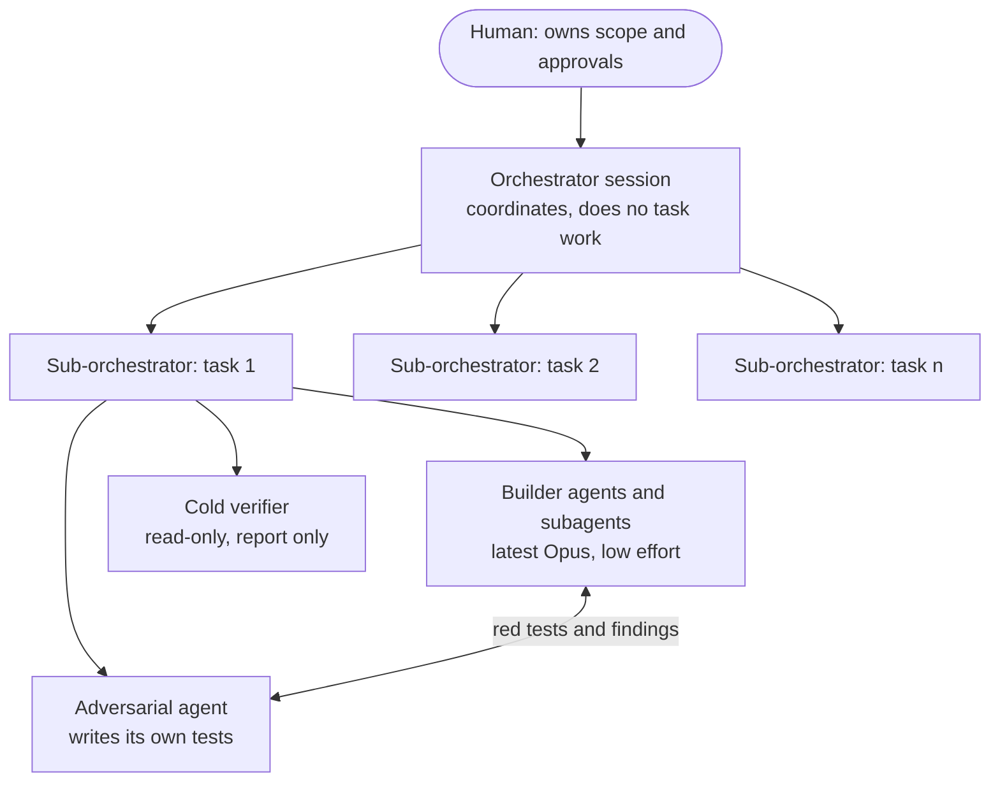
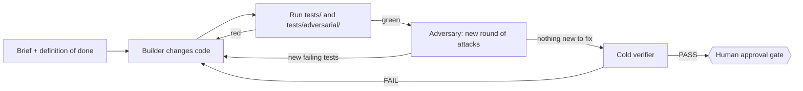
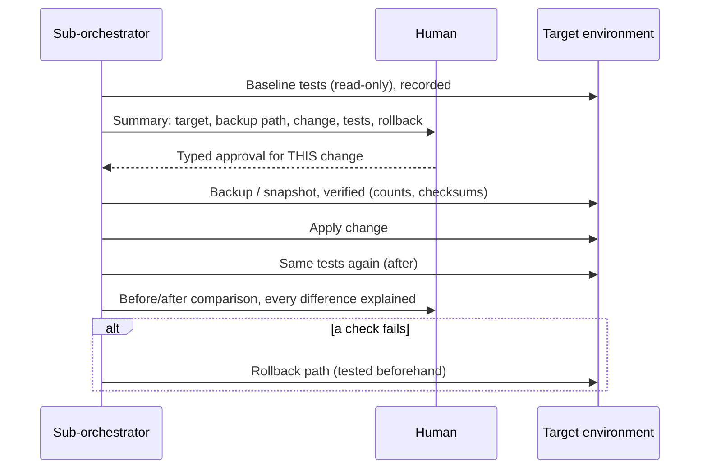

# The method: governed AI delivery

This is how every project in this repo was built: by directing a team of Claude Code agents,
with an adversarial agent that writes its own tests and a human approval gate in front of
every change. The same working pattern was used on client work for a large financial-services
client (see [case-studies.md](case-studies.md)); this repo re-creates the shapes of those
problems on synthetic data so the method can be inspected end to end.

## 1. The roles

| Role | Does | Does not |
|---|---|---|
| **Orchestrator** | Splits the work, starts one sub-orchestrator per task, keeps the shared state record, relays the human's decisions verbatim | Do task work itself |
| **Sub-orchestrator** | Owns one task: brief, findings, status, evidence pack | Change an environment without the human's yes |
| **Builder** ([template](agents/builder.md)) | Implements, iterates until every test is green | Edit the adversary's tests |
| **Adversary** ([template](agents/adversary.md)) | Attacks the work, writes tests in `tests/adversarial/`, logs every round in `ADVERSARIAL-LOG.md` | Fix the code |
| **Verifier** ([template](agents/verifier.md)) | Cold, read-only final review, including whether each claim has evidence | Fix anything |
| **Router** ([template](agents/router.md)) | Picks the cheapest adequate model rung | Do the work |

Why the builder runs on the latest Opus at **low** effort: the adversary's tests are a
machine verifier, so a wrong attempt costs seconds, not a human review cycle. A strong model
at low effort makes fast attempts and needs fewer of them; the tests carry the rigour.

## 2. The build loop

Each project's `ADVERSARIAL-LOG.md` records the rounds: what the adversary attacked, which of
its tests failed first, what the builder fixed, and the final state.

## 3. The change lifecycle (when something real is touched)

- **Approval is per change and per environment.** One yes does not cover the next change.
- **Backup before every change**, and the backup is checked (row counts, a checksum manifest),
  not assumed.
- **The same tests run before and after**, so "nothing broke" is a comparison, not an opinion.
- **The rollback path is written and tested before the change runs.** A rollback claim that
  has not been tested is treated as false; in the real work, a reviewer caught exactly that.

## 4. The model-routing ladder

Start at R2 and move by the signals in the task; measured history (a ledger of past runs and
each executor's own "held / strained / too low / too high" verdict) overrides the table.

| Rung | Model tier | Effort | Typical work |
|---|---|---|---|
| R0 | Haiku | low | classify, extract, rename, reformat, route |
| R1 | Haiku | medium | the same, with a wrinkle |
| **R2** | Sonnet | medium | **default**: most production work |
| R3 | Sonnet | high | long multi-step or unattended work |
| R4 | Opus | medium | architecture, trade-offs, hard debugging |
| R5 | Opus | high | the above, unattended or hard to check |
| R6 | top tier | medium | ceiling; only when R5 failed on capability |
| Check | Sonnet | high | cold read-only verifier |

Rules that matter more than the table:
- **Is there a machine verifier?** If yes, cheap iteration is allowed. If only a human can
  judge the result, go straight to the right rung; a retry costs a review cycle.
- **High stakes is decided by rule**, not feel: irreversible, leaves the building, money or
  standing, regulated. High stakes adds a rung and disables cheap iteration.
- **"+1 effort" is not "+1 rung".** Raise effort within a model before switching model.

## 5. The harness: hooks that force process

[`harness/`](harness/) holds the guard script behind this method: one Python file,
`arc_guard.py`, wired to five Claude Code hook events. In a project that opts in (an `.arc`
file in its root):

| Guarantee | Mechanism |
|---|---|
| A turn that changed files cannot end until the project's checks have actually run | `Stop` hook, exit code 2 |
| While a fix is in progress, the tests that gate it cannot be edited | `PreToolUse` deny while `.claude/arc/fix.lock` exists |
| Every delegation to a rung agent is logged to a ledger | `PostToolUse` on the agent tool |
| The routing rules are in context from turn one | `SessionStart` output |

Exit code 1 appears nowhere: in a hook, exit 1 does **not** block. That one detail is the most
common way a gate silently does nothing, and the test suite asserts exit 2 explicitly.

Run the tests: `python method/harness/test_arc_guard.py` (no dependencies).
Recorded result in this repo: **41 passed, 0 failed** (Python 3.13, Windows).

## 6. Honest limits

- **The hooks are opt-in.** They do nothing in a project without an `.arc` file.
- **Interactive sessions only.** Headless runs (`claude -p`) skip hook discovery, so none of
  the guarantees apply in CI or scripted runs; those rely on explicit flags and on checking
  the exit code and output.
- **Fail-open by design.** If the guard script crashes it exits 0 so it can never wedge a
  session; the error is logged and shown at the next session start. A visible open gate was
  chosen over an invisible closed one.
- **Hooks force process, never judgement.** No hook can tell whether the brief was right, the
  rung was right, or the task was worth doing.
- **The rest of the method is a working rule, not mechanical enforcement.** One sub-orchestrator
  per task, the adversary, the approval gate, backup-before-change: these are how the work
  was run, backed by independent review, not guaranteed by code. In the real client cases the
  enforcement hooks had run only on a demo project; those cases ran on working practice plus
  independent review.
- **No cost outcome is claimed** for the routing ladder.
